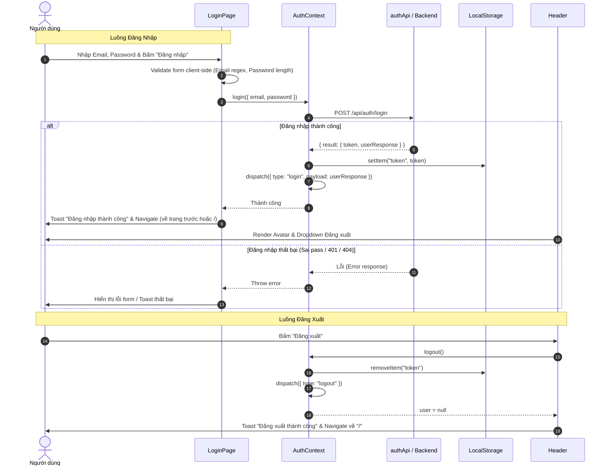

# Kế Hoạch Triển Khai Trang Login & Luồng Logout

Tài liệu này mô tả chi tiết kế hoạch thiết kế, kiến trúc dữ liệu và triển khai giao diện, luồng xử lý cho **Trang Đăng nhập (Login)** và **Chức năng Đăng xuất (Logout)** trên ứng dụng Frontend `ticket-booking-fe`, đồng bộ với Backend Spring Boot API hiện có.

---

## 1. Danh Sách Nhiệm Vụ (Todo Checklist)

### Giai đoạn 1: Chuẩn hóa Tầng Auth Context & API
- [ ] **Task 1.1**: Cập nhật `src/api/userApi.js` đường dẫn `/user/user` tương ứng Backend `UserController.java`.
- [ ] **Task 1.2**: Nâng cấp `src/contexts/AuthContext.js`:
  - [ ] Thêm state `isLoading` để hỗ trợ chờ xác thực khi người dùng refresh (F5).
  - [ ] Cập nhật hàm `login()` lưu `token` và `dispatch` đúng payload `userResponse`.
  - [ ] Cập nhật hàm `logout()` xóa token, reset user state.
  - [ ] Cập nhật hàm `getUserFromToken()` với khối `finally { setIsLoading(false) }`.
- [ ] **Task 1.3**: Cập nhật `src/routes/ProtectedRoute.jsx` kiểm tra cờ `isLoading` (hiển thị loading indicator trong khi chờ xác thực token thay vì vội redirect).
- [ ] **Task 1.4**: Tích hợp `<Toaster position="top-right" />` từ thư viện `react-hot-toast` vào `src/App.js` để hỗ trợ thông báo toàn cục.

### Giai đoạn 2: Xây dựng Trang Đăng Nhập (LoginPage)
- [ ] **Task 2.1**: Thiết lập file kiểu dáng `src/pages/public/LoginPage.css`:
  - [ ] Style container nền dịu mắt, card đăng nhập nổi bật với bo góc và shadow mềm.
  - [ ] Style icon input, nút toggle hiển thị mật khẩu (`Eye`/`EyeOff`), trạng thái hover/focus.
- [ ] **Task 2.2**: Hoàn thiện logic & UI trong `src/pages/public/LoginPage.jsx`:
  - [ ] Quản lý form state: `email`, `password`, `rememberMe`, `showPassword`, `isSubmitting`, `errors`.
  - [ ] Client-side validation: kiểm tra email rỗng / định dạng không hợp lệ; kiểm tra password rỗng / dưới 6 ký tự.
  - [ ] Toggle ẩn/hiện mật khẩu mượt mà với icon của `lucide-react`.
  - [ ] Tính năng "Ghi nhớ tài khoản": tự động điền lại email đã lưu từ `localStorage`.
  - [ ] Gọi hàm `login({ email, password })` từ `useAuth()`, hiển thị spinner loading khi đang gửi request.
  - [ ] Hiển thị thông báo lỗi (Banner Alert / Toast) khi đăng nhập thất bại.
  - [ ] Xử lý điều hướng thông minh sau đăng nhập: chuyển về trang trước đó (`location.state.from`) hoặc `/`.
  - [ ] Tự động chuyển hướng khỏi `/login` nếu người dùng đã đăng nhập từ trước.
  - [ ] Thêm link điều hướng sang trang Đăng ký (`/register`) và Quên mật khẩu.

### Giai đoạn 3: Tích hợp Luồng Đăng Xuất & Cập nhật Header
- [ ] **Task 3.1**: Cập nhật `src/components/common/Header.jsx`:
  - [ ] Sửa sự kiện bấm "Đăng nhập" để điều hướng `navigate("/login")` (thay vì gọi `login()` rỗng như hiện tại).
  - [ ] Thêm liên kết tới trang Đăng ký `/register` cạnh nút Đăng nhập.
- [ ] **Task 3.2**: Xây dựng User Dropdown Menu trên Header khi đã đăng nhập:
  - [ ] Hiển thị badge avatar / icon người dùng và email hiển thị.
  - [ ] Hiển thị vai trò (Role badge: USER / ADMIN).
  - [ ] Menu lựa chọn: Lối tắt "Vé của tôi" (`/your-tickets`), "Cài đặt tài khoản".
  - [ ] Nút "Đăng xuất" có icon `LogOut`.
- [ ] **Task 3.3**: Xử lý logic đăng xuất:
  - [ ] Khi click "Đăng xuất": gọi `logout()`, xóa token, xóa user context.
  - [ ] Hiển thị toast `toast.success("Đăng xuất thành công!")`.
  - [ ] Điều hướng về trang chủ `/` (hoặc `/login` nếu đang ở trang riêng tư).

### Giai đoạn 4: Kiểm Thử & Tối Ưu Hóa (Testing & Verification)
- [ ] **Task 4.1**: Chạy build kiểm tra cú pháp và warnings: `cmd /c "npm run build"`.
- [ ] **Task 4.2**: Kiểm thử thủ công các ca kiểm thử (happy path, sai mật khẩu, sai định dạng, refresh F5, truy cập protected route khi chưa đăng nhập, logout).

---

## 2. Mục Tiêu & Yêu Cầu Tổng Quan (Goals & Requirements)

1. **Trang Đăng nhập (LoginPage)**:
   - Giao diện hiện đại, chuyên nghiệp, responsive theo phong cách đặt vé (sử dụng React-Bootstrap + Lucide Icons + CSS variables dự án).
   - Card đăng nhập trung tâm với logo/biểu tượng thương hiệu `Ticket Booking`.
   - Form đăng nhập gồm các trường:
     - **Email**: validation định dạng email, bắt buộc nhập.
     - **Mật khẩu**: validation độ dài tối thiểu 6 ký tự, có nút toggle Ẩn/Hiện mật khẩu (`Eye` / `EyeOff`).
     - **Ghi nhớ đăng nhập (Remember me)**: lưu email vào `localStorage` nếu được chọn.
     - Liên kết chuyển hướng nhanh đến trang Đăng ký (`/register`) và Quên mật khẩu.
   - Xử lý trạng thái:
     - Loading spinner trên nút Submit khi đang gửi API.
     - Hiển thị thông báo lỗi (inline feedback dưới input + banner/toast khi sai tài khoản hoặc lỗi server).
   - Điều hướng thông minh:
     - Nếu đã đăng nhập mà truy cập `/login` -> tự động redirect về trang chủ `/` hoặc trang trước đó.
     - Sau khi đăng nhập thành công -> lưu JWT token, cập nhật trạng thái User vào Context, hiển thị Toast thông báo và redirect về trang trước đó (`location.state.from`) hoặc `/`.

2. **Chức năng Đăng xuất (Logout)**:
   - Tích hợp tại thanh điều hướng `Header`:
     - Khi chưa đăng nhập: hiển thị nút "Đăng nhập" (dẫn đến `/login`) và "Đăng ký" (`/register`).
     - Khi đã đăng nhập: hiển thị Menu người dùng (Avatar/Icon + Email/Role) cùng Dropdown:
       - Thông tin tài khoản & vai trò.
       - Lối tắt "Vé của tôi" (`/your-tickets`).
       - Nút "Đăng xuất" (với icon `LogOut`).
   - Xử lý khi nhấn Đăng xuất:
     - Xóa `token` khỏi `localStorage`.
     - Reset `user` state trong `AuthContext` về `null`.
     - Hiển thị thông báo Toast "Đã đăng xuất thành công".
     - Chuyển hướng người dùng về trang chủ `/` hoặc `/login`.

3. **Cải tiến & Chuẩn hóa Hạ tầng Auth (Auth Context & Interceptor)**:
   - Bổ sung cờ `isLoading` trong `AuthContext` để tránh trường hợp `ProtectedRoute` tự động redirect về `/login` khi người dùng reload trang F5 trong lúc `getUserFromToken()` đang chạy.
   - Sửa lỗi mapping dữ liệu giữa Backend và Frontend:
     - Backend `POST /api/auth/login` trả về `result: { userResponse: { id, email, role }, token }`.
     - Frontend `AuthContext` cần lưu chuẩn `user` là `result.userResponse` và lưu token vào `localStorage`.
     - Sửa endpoint lấy thông tin người dùng trong `userApi.js`: đường dẫn Backend thực tế là `/user/user` (thay vì `/user`).
   - Tích hợp `react-hot-toast` (`<Toaster />`) để hiển thị thông báo trạng thái đẹp mắt.

---

## 3. Luồng Dữ Liệu & Kiến Trúc (Architecture & Flow)



---

## 4. Các Thay Đổi Chi Tiết (Proposed Changes)

### A. Tầng Auth & API (Foundation)

#### [MODIFY] `src/api/userApi.js`
- Cập nhật đúng endpoint theo `UserController.java` của Backend: `@RequestMapping("/api/user")` + `@GetMapping("/user")` -> path gọi qua axios là `/user/user`.

```javascript
import { createAuthApi } from "./axios";

export const userApi = {
  getUser: (token) => createAuthApi(token).get("/user/user"),
};
```

#### [MODIFY] `src/contexts/AuthContext.js`
- Thêm state `isLoading` (mặc định `true`) để phục vụ `ProtectedRoute` và các trang kiểm tra trạng thái đăng nhập.
- Chuẩn hóa hàm `login`:
  - Lưu `token` từ `loginResponse.result.token`.
  - Dispatch user với `loginResponse.result.userResponse`.
- Chuẩn hóa hàm `logout`:
  - Xóa `token`.
  - Dispatch logout.
- Chuẩn hóa `getUserFromToken`:
  - Khi token hợp lệ: lấy thông tin user qua `userApi.getUser(token)`, dispatch `userData.result`.
  - Xử lý `finally`: đặt `isLoading = false`.

```javascript
export const AuthProvider = ({ children }) => {
  const [user, dispatch] = useReducer(userReducer, null);
  const [isLoading, setIsLoading] = useState(true);

  const login = async (userData) => {
    const loginResponse = await authApi.login(userData);
    localStorage.setItem("token", loginResponse.result.token);
    dispatch({ type: "login", payload: loginResponse.result.userResponse });
    return loginResponse;
  };

  const logout = () => {
    localStorage.removeItem("token");
    dispatch({ type: "logout" });
  };
  ...
```

#### [MODIFY] `src/routes/ProtectedRoute.jsx`
- Bổ sung xử lý khi `isLoading === true`: hiển thị spinner / loading placeholder thay vì bị redirect vội vàng về `/login`.

---

### B. Tầng Giao Diện Người Dùng (UI Layer)

#### [MODIFY] `src/pages/public/LoginPage.jsx` & [NEW] `src/pages/public/LoginPage.css`
- Thiết kế giao diện Card đăng nhập hiện đại:
  - Header: Logo Ticket Booking, tiêu đề "Chào mừng trở lại", phụ đề mô tả ngắn.
  - Alert thông báo lỗi server (nếu có).
  - Input Email có validation icon và helper text.
  - Input Password có nút toggle con mắt `Eye` / `EyeOff`.
  - Row tiện ích: Checkbox "Ghi nhớ tài khoản", Link "Quên mật khẩu?".
  - Nút Submit với hiệu ứng hover và loading state khi `submitting`.
  - Divider "hoặc".
  - Footer Card: "Chưa có tài khoản? Đăng ký ngay".
- Tự động điền email nếu trước đó người dùng chọn "Ghi nhớ".
- Kiểm tra nếu `user` đã tồn tại thì điều hướng ngay khỏi trang login.

#### [MODIFY] `src/components/common/Header.jsx`
- Sửa hàm `handleLogin`: thay vì gọi `login()` chay, chuyển hướng đến `navigate("/login")`.
- Khi người dùng đã đăng nhập:
  - Thay thế nút đăng xuất đơn điệu bằng User Nav Dropdown chuyên nghiệp (`Dropdown` của react-bootstrap).
  - Hiển thị email hoặc avatar đại diện + role badge (USER / ADMIN).
  - Menu gồm: "Vé của tôi", "Cài đặt tài khoản" (tùy chọn), Đường kẻ phân cách, và "Đăng xuất" với icon `LogOut`.
- Khi bấm "Đăng xuất":
  - Thực hiện `logout()`.
  - Bắn toast `toast.success("Đăng xuất thành công!")`.
  - Chuyển về trang chủ `/`.

#### [MODIFY] `src/App.js`
- Thêm `<Toaster position="top-right" />` từ `react-hot-toast` vào root component để hiển thị thông báo phản hồi (success, error) cho toàn bộ ứng dụng.

---

## 5. Kế Hoạch Xác Minh & Kiểm Thử (Verification Plan)

### Kiểm Thử Tự Động (Automated Build & Lint)
- Chạy lệnh build kiểm tra lỗi cú pháp và cảnh báo:
  `cmd /c "npm run build"`

### Kịch Bản Kiểm Thử Thủ Công (Manual Verification Flow)
1. **Truy cập Trang Đăng nhập (`/login`)**:
   - Nhấn nút "Đăng nhập" ở Header -> Kiểm tra URL chuyển thành `/login`.
   - Kiểm tra hiển thị đầy đủ các trường, icon mắt ẩn/hiện mật khẩu hoạt động tốt.
2. **Kiểm tra Validation Form Client-side**:
   - Để trống và bấm Đăng nhập -> Báo lỗi yêu cầu nhập email và mật khẩu.
   - Nhập email sai định dạng (vd: `abc`) -> Báo lỗi email không hợp lệ.
   - Nhập mật khẩu < 6 ký tự -> Báo lỗi độ dài mật khẩu.
3. **Đăng nhập với Thông tin Không Đúng**:
   - Nhập email/password không tồn tại -> Kiểm tra hiển thị thông báo lỗi từ API (Alert và/hoặc Toast).
   - Nút đăng nhập không bị treo loading.
4. **Đăng nhập Thành công**:
   - Nhập tài khoản chính xác -> Nút hiển thị spinner "Đang đăng nhập...".
   - API trả về thành công -> Toast thông báo "Đăng nhập thành công!", token được lưu trong `localStorage`.
   - Tự động chuyển hướng về trang chủ `/` (hoặc trang được bảo vệ trước đó).
   - Header hiển thị menu tài khoản người dùng thay cho nút "Đăng nhập".
5. **Duy trì Trạng thái khi Refresh (F5)**:
   - F5 lại trang -> Người dùng vẫn ở trạng thái đã đăng nhập (lấy lại info từ token).
   - Truy cập thủ công vào `/login` -> Tự động bị redirect về `/`.
6. **Đăng xuất (Logout)**:
   - Mở Menu người dùng tại Header -> Bấm "Đăng xuất".
   - Token trong `localStorage` bị xóa, user state trở về `null`.
   - Toast "Đã đăng xuất thành công".
   - Header chuyển lại về nút "Đăng nhập".
   - Nếu đang ở trang được bảo vệ (`/your-tickets`) -> Bị chuyển hướng về `/login`.
